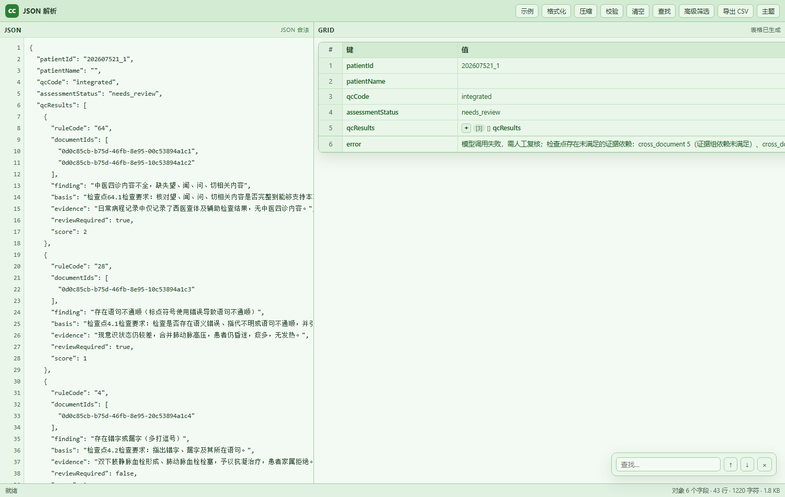

# CC 工具箱 · JSON 解析（DBX 插件）

在 DBX 工作台里直接解析、浏览 JSON——不需要启动外部程序。



## 功能（工具箱）

侧边栏模块（与桌面版 CC 工具箱对应）：

| 模块 | 状态 |
|---|---|
| JSON 数据解析 | ✅ 完整（表格/嵌套展开/定位高亮/多页签/筛选/导出） |
| JSON 内容比对 | ✅ 结构差异（新增/删除/修改节点路径）+ 文本行差异 + JSON 文件导入 |
| CSV 文件预览 | ✅ 本地 CSV 解析、分页显示（前 500 行）、行列统计 |
| CSV 内容比对 | ✅ 双文件、主键/行号匹配、新增/删除/修改行统计、导出差异 CSV |
| 在线绘图工具 | ✅ 画板（颜色/粗细/清空/导出 PNG） |
| 系统参数配置 | ✅ 主题、字号缩放、清除缓存 |
| 首页数据概览 | ✅ 读取 DBX 连接列表/状态/方言/数据库，可查询表数量；提供各工具快捷入口 |
| 临时数据建表 | ✅ 导入 **Excel(.xlsx/.xls)/CSV 文件**或粘贴 JSON/CSV → 推断字段类型 → 生成 CREATE TABLE + 批量 INSERT（批量行数可在设置里调） |
| 快速建数据表 | ✅ 自定义字段/类型/主键/非空 → 生成 CREATE TABLE；支持粘贴 INSERT SQL 自动解析字段与类型 |
| 数据验证排查 | ✅ 生成空值/重复/超长/枚举校验 SQL；连接可用时直接执行只读校验；**离线版**支持粘贴 INSERT/CSV/JSON 本地校验（空值/重复/长度/枚举/正则）并导出报告 |
| 发票打印操作 | ✅（Windows x64，原生侧车）：导入 **PDF/图片发票**、每页 1/2/4 张、A4/发票纸、套打偏移(mm)、选择打印机、预览、批量打印 |


- **多解析窗口**：顶部页签可新增/关闭/切换多个 JSON 解析窗口，各自保留内容；双击页签可重命名


- **JSON 文本区**：行号、语法错误定位（行/列）、格式化、压缩、校验、清空、查找
- **表格区（GRID）**：
  - 对象 → 键值表；对象数组 → 多列表格（列自动合并）
  - 嵌套对象/数组：`[+] [n] {}` / `[+] [n] []` 展开，展开后嵌套表格最多 420px 高、内部滚动
  - 类型着色（字符串/数字/布尔/null）、行号、单元格省略 + 悬停全文
  - 展开行整行跨列，宽度自适应
- **高级筛选**：用 JS + lodash（`_`）处理数据，例如 `return data.qcResults.filter(x => x.score > 1)`
- **导出 CSV**（对象数组按列导出）
- **主题**：默认淡绿阅读配色；跟随 DBX 深色主题自动切换

## 本地开发

```bash
cd dbx-cc-toolbox
node _serve.cjs ./ui 5199        # 本地静态服务器（开发用）
# 浏览器打开 http://127.0.0.1:5199/index.html
node test-grid.mjs               # 表格渲染/CSV/解析错误定位的单元测试
```

## 打包

```bash
npm i -g @dbx-app/plugin-cli
dbx-plugin package .
# 产物：dist/com.cctoolbox.json-<version>-universal.dbxp
```

## 安装到 DBX

插件仓库已托管到 GitHub Pages（无需本地服务）：

1. DBX → 插件中心 → 设置 → 插件仓库：
   - 仓库 ID `cctoolbox.local`
   - 名称 `CC 工具箱自托管仓库`
   - Catalog URL `https://fangmingzhao69-glitch.github.io/dbx-cc-toolbox/catalog/index.json`
   - 添加仓库
2. 同页「仓库信任设置」：Key ID `cctoolbox-local-2026`，Public Key `/c3/+1FI+BT/jfMp05ZFxjoYuCRbhFKAiv+0d7Br4Qo=` → 保存
3. 刷新插件商店，搜索「CC 工具箱」→ 安装
4. 顶部工具栏/命令面板打开「CC 工具箱 · JSON 解析」

详见 [repo/README.md](repo/README.md)。

> 备用：本地服务 `repo\start-repo.cmd`，或插件中心 → 设置 → 勾选「允许安装未签名开发包」后从文件安装 `dist\*.dbxp`。

## 目录结构

```
manifest.json        插件契约（workbench / command / menus 贡献点）
dbx-plugin.toml      打包配置
assets/plugin.svg    插件图标
ui/
  index.html         沙箱页面
  styles.css         淡绿 / 深色主题
  js/json-grid.js    JSON → 表格渲染器（纯函数，可单测）
  js/app.js          页面交互、Host API 桥接
  assets/lodash.min.js
repo/                自托管签名仓库（build-repo.mjs / serve.cjs）
dist/                未签名打包产物
```

## 提交官方商店（可选）

官方商店要求由 DBX Store 审核并签名，流程见 https://dbxio.com/cn/docs/plugin-development ：

1. 把本目录推到公开 GitHub 仓库，替换 `submit/` 与 `.dbx-store.json` 里的 `fangmingzhao69-glitch`；
2. 打 tag `v0.1.0` 并发布 Release（`.github/workflows/plugin-release.yml` 会自动构建未签名候选包并上传）；
3. Fork `t8y2/dbx-store`，提交一个 PR：`publishers/cctoolbox.json` + `candidates/com.cctoolbox.jsongrid.json`（文件在 `submit/` 下，PR 描述用 `submit/PR_BODY.md`）；
4. CI 会保持红色并提示 "awaiting DBX Store signing"（正常）；维护者审核后运行签名工作流，最终目录写回 PR，合并后即可在官方插件商店安装。

注意：候选包必须与 Release 里的**未签名** `.dbxp` 字节一致（SHA-256 `aa1bccc4…c3e7`，41,129 字节）。

## 路线图

- [ ] result-view 贡献点：在 DBX 查询结果里直接把 json/jsonb 列渲染成网格
- [ ] 单元格点击定位 JSON 原文
- [ ] 列筛选、排序、快速搜索